# Moztoba Mutashim Billah

I studied business analytics at Sunway University in Malaysia (Master of Business Analytics). I build projects with public data, from the raw files to a dashboard or a web app people can use.

## Projects

### CareerShield

AI exposure and career moves for Malaysian workers. It scores 894 occupations on three published measures of AI exposure, maps them to Malaysia's occupational classification (MASCO) and suggests moves with Malaysian salaries and courses for the skill gaps. It started as my capstone project with Aritra Paul, supervised by Dr Mohammed Al-Obaydee. A journal paper on its evaluation is in preparation.

[Live site](https://moz700.github.io/CareerShield/) · [Code](https://github.com/Moz700/CareerShield)

### Malaysia Price Watch

SQL analysis of 21 million Malaysian grocery prices (KPDN PriceCatcher, October 2025 to September 2026) in PostgreSQL 16, with a star schema, 7 quality checks, 31 business questions, a live web dashboard and a Power BI project.

[Dashboard](https://moz700.github.io/malaysia-price-watch/dashboard/) · [Code](https://github.com/Moz700/malaysia-price-watch)

## Tools in these projects

Python, PostgreSQL, Power BI.

## Contact

I'm looking for data and business analyst roles.

[LinkedIn](https://www.linkedin.com/in/moztoba-mutashim-billah) · moztobamutashim@gmail.com

  

